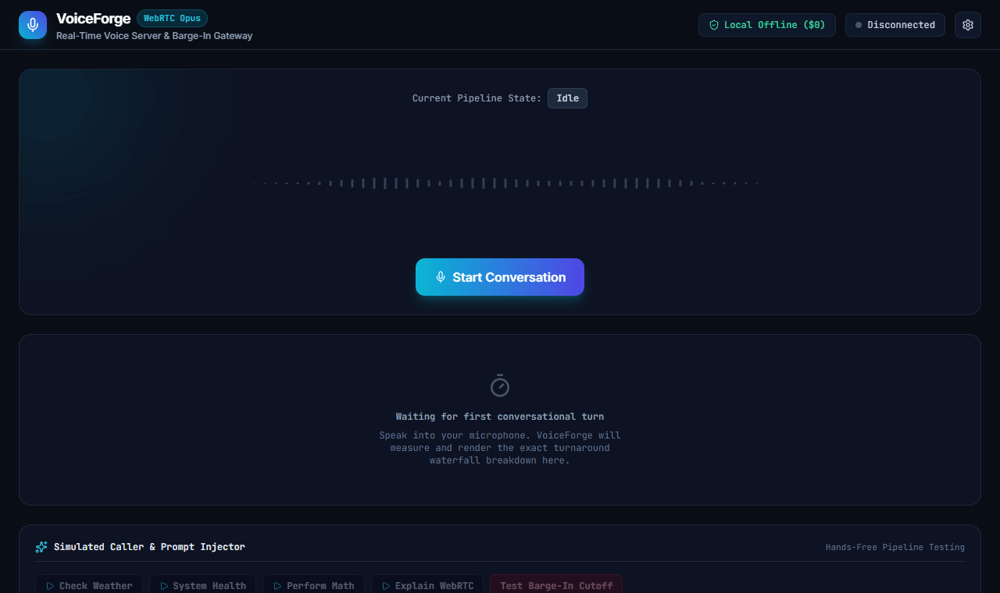

# VoiceForge

Open-source real-time voice agent server built in Python 3.12 (aiortc, onnxruntime, fastapi) and React 19.

VoiceForge provides a self-hosted alternative to the OpenAI Realtime API. It handles low-latency WebRTC audio streaming, executes Silero VAD v5 locally on CPU for sub-80ms barge-in interruptions, and pipelines speech-to-text, streaming language models, and text-to-speech with end-to-end turnaround under 450 milliseconds.

<p align="center">
  
</p>

---

## Key Features

- **Full-Duplex WebRTC Gateway**: Connects directly to browsers and mobile clients over UDP with Opus audio encoding (48kHz), with WebSocket streaming fallback.
- **Sub-80ms Barge-In Controller**: Silero VAD v5 runs in-process via ONNX Runtime (<2ms CPU inference), immediately muting outgoing audio and halting LLM token streams the millisecond user speech is detected.
- **Acoustic Self-Echo Guard**: Dynamically raises VAD detection thresholds and consecutive frame verification while the assistant audio plays through open laptop speakers, preventing false barge-in loops.
- **Adaptive Noise Floor Tracker**: Continuously computes ambient background sound levels via exponential moving average to avoid spurious triggers in noisy rooms.
- **Turnaround Under 450ms**: Overlaps STT output, LLM token streaming, punctuation-based sentence chunking, and TTS synthesis so playback begins on the first sentence.
- **Dual Pipeline Support**:
  - **Cloud Mode**: Deepgram Nova-2 + Claude 3.5 Sonnet / OpenAI GPT-4o + Cartesia Sonic.
  - **Local Mode (Cost $0)**: Whisper Local / Sherpa-ONNX + Ollama / local LLM + Kokoro-82M / Native PCM.
- **Conversational Tool Execution**: Asynchronous function calling mid-conversation with natural vocal filler generation ("Let me look into that for you...") to prevent dead air. Supports dynamic in-browser webhook tool registration.
- **Dual-Track Stereo WAV Recorder**: Records synchronized user audio on the left channel and assistant audio on the right channel, downloadable after each call.
- **Interactive React 19 Studio**: Real-time dual audio visualizer, live latency waterfall chart, conversational transcript, active tool monitor, microphone device selector with live VU meter, WebRTC network quality RTT badge, and session report export (JSON/Markdown).

---

## Architecture Overview

```
                                    VOICEFORGE
                                         |
         +-------------------------------+-------------------------------+
         |                                                               |
+--------v------------------------+             +------------------------v-------+
|   WebRTC Full-Duplex Gateway    |             |     Silero VAD & Barge-In      |
| * UDP Opus audio in and out     |             | * ONNX Runtime (<2ms CPU)      |
| * aiortc peer connection engine |             | * 32ms frame sliding window    |
| * WebRTC data channel events    |             | * Sub-80ms instant mute        |
| * WebSocket streaming fallback  |             | * Abort signal coordinator     |
+--------+------------------------+             +------------------------+-------+
         |                                                               |
         +-------------------------------+-------------------------------+
                                         |
                         +---------------v---------------+
                         |   Streaming Voice Pipeline    |
                         | * STT: Deepgram, Whisper      |
                         | * LLM: Claude, GPT-4o, Ollama |
                         | * TTS: Cartesia, Kokoro, OS   |
                         +---------------+---------------+
                                         |
                         +---------------v---------------+
                         |   Conversational Tool Runner  |
                         | * Mid-dialogue tool execution |
                         | * Context-aware vocal fillers |
                         | * Session state memory        |
                         +---------------+---------------+
                                         |
                         +---------------v---------------+
                         |  Interactive React 19 Studio  |
                         | * Real-time audio waveform    |
                         | * Turnaround latency waterfall|
                         | * Live transcript & barge-in  |
                         +-------------------------------+
```

---

## Quickstart

### Prerequisites
- Python 3.11 or 3.12
- Node.js 20 or higher
- Microphone and speakers for browser testing

### 1. Installation

Clone the repository and set up a Python virtual environment:

```bash
git clone https://github.com/alexandrmotologa/voiceforge.git
cd voiceforge

python -m venv .venv
source .venv/bin/activate  # On Windows: .venv\Scripts\activate
pip install -e .
```

### 2. Configure Environment

Create a `.env` file from the example:

```bash
cp .env.example .env
```

Set your API keys (optional if running in 100% local offline mode):

```env
# Server settings
HOST=0.0.0.0
PORT=8765

# Cloud providers (optional)
DEEPGRAM_API_KEY=your_deepgram_key
ANTHROPIC_API_KEY=your_anthropic_key
OPENAI_API_KEY=your_openai_key
CARTESIA_API_KEY=your_cartesia_key

# Local model settings
OLLAMA_BASE_URL=http://localhost:11434/v1
OLLAMA_MODEL=llama3.1:8b
VAD_THRESHOLD=0.5
```

### 3. Start the Server

```bash
voiceforge serve --port 8765
```

The server exposes:
- WebRTC signaling: `http://localhost:8765/session/offer`
- WebSocket stream: `ws://localhost:8765/session/{id}/stream`
- Health check: `http://localhost:8765/health`

### 4. Launch the Web Studio

```bash
cd web
npm install
npm run dev
```

Open `http://localhost:5173` in your browser. Click **Connect**, allow microphone permissions, and start speaking.

---

## Command Line Interface

VoiceForge includes a CLI powered by Typer:

```bash
# Start server with live reload
voiceforge serve --host 0.0.0.0 --port 8765 --reload

# Run benchmark on Silero VAD v5 inference
voiceforge benchmark --frames 1000

# Test VAD on an existing WAV recording
voiceforge test-vad path/to/sample.wav --threshold 0.5
```

---

## Studio Tools & Diagnostic Features

VoiceForge Studio in `web/` includes testing and observability tools built into the UI:

- **Microphone Selector & Pre-flight VU Meter**: Choose any available audio input device and verify ambient audio and speaking levels before connecting.
- **Simulated Caller & Prompt Injector**: Send simulated caller utterances or trigger a manual barge-in test to benchmark interruption latency without speaking into the microphone.
- **WebRTC Network Quality Monitor**: Continuously reads round-trip time (RTT), packet jitter, and packet loss via `RTCPeerConnection.getStats()` every 2 seconds.
- **Dual-Track WAV Recording Export**: Automatically buffers inbound microphone audio on channel 0 and assistant speech on channel 1. Download the stereo WAV recording at `/session/{id}/recording`.
- **Session Reports**: Export comprehensive call transcripts, latency breakdowns, and tool invocation audits in JSON or Markdown format via `/session/{id}/report`.
- **Persona Presets**: Instantly switch between Technical Support, Executive Assistant, and Friendly Conversationalist system prompts with tuned temperature and speech rate sliders.
- **Dynamic Tool Webhook Registration**: Add custom tools at runtime by specifying a tool name, description, JSON schema, and HTTP POST webhook endpoint.

---

## Latency Waterfall

Conversational turnaround time from the user finishing speech to the assistant's first audio frame:

```
User finishes speaking (T0)
  |--- [120ms] VAD Silence Confirmation
  |--- [110ms] STT Final Transcript (Deepgram)
  |--- [125ms] LLM First Token (Claude 3.5 Sonnet)
  |--- [ 18ms] First Sentence Delimited
  |--- [ 80ms] TTS Audio Chunk (Cartesia Sonic)
  v
Assistant sound reaches ear (T5) => Total Turnaround: ~453ms
```

---

## Tool Calling with Vocal Fillers

Tools are registered using the `@register_tool` decorator. If a tool requires network latency, VoiceForge speaks an appropriate conversational filler before tool execution finishes:

```python
from src.tools.registry import register_tool

@register_tool(
    name="get_weather",
    description="Get current weather for a city",
    filler="Checking current conditions for you..."
)
async def get_weather(city: str) -> dict:
    # Asynchronous external API call
    return {"city": city, "temperature_c": 19, "condition": "Partly Cloudy"}
```

---

## Development & Testing

Run unit and integration tests:

```bash
pytest tests/ -v
```

---

## License

MIT License. See [LICENSE](LICENSE) for details.
